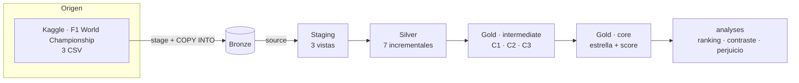

# F1 · ¿Quién es el mejor piloto, independientemente del coche?
 
**Pilotos de Fórmula 1 2000-2024, comparados sin la ayuda (ni el lastre) de su coche.**
Data warehouse en **Snowflake + dbt** con arquitectura Medallion que parte de resultados, clasificaciones y calendario de F1 y construye un *score* por piloto y temporada que aísla el factor piloto. Con él responde a una pregunta principal y a una segunda lectura:
 
| Pregunta | Dónde se responde |
|---|---|
| ¿Quién es el mejor piloto 2000-2024, independientemente del coche? | `analyses/ranking.sql` sobre `fct_driver_season` |
| ¿En qué cambia ese ranking frente al ranking en bruto (por victorias)? | `analyses/ranking_bruto_vs_ajustado.sql` |
| ¿Qué equipo ha perjudicado más a cada piloto del top 15? | `analyses/perjuicio_coche.sql` |
 
> Proyecto final del curso de Data Engineering · Cívica · noviembre de 2026
 
---
 
## El problema y el método
 
Victorias y campeonatos no sirven para comparar pilotos: están contaminados por la calidad del coche. El score combina tres métricas, todas de posición y calculadas por temporada:
 
| Métrica | Qué mide | Signo |
|---|---|---|
| **C1** · duelo con el compañero | % de duelos ganados al compañero de equipo (carrera, clasificación y sprint). Mismo coche, así que aísla al piloto | + |
| **C2** · incidentes propios | Frecuencia con que abandona por error o incidente suyo (colisión, accidente, trompo) | − |
| **C3** · rendimiento frente al coche | Posiciones ganadas respecto a lo que se espera de su coche, medido por el puesto de su constructor en el campeonato | + |
 
```
score = (z_C1 − z_C2 + z_C3) / 3
```
 
- Los **z-scores se calculan dentro de cada temporada**, solo con muestras fiables (`min_valid_races`, `min_duels`), para no comparar épocas distintas.
- Las **averías** (estado `mechanical`) y los que no salen (`not_started`) no cuentan: la clasificación de estados vive en la seed `status_classification`.
- El **ranking** pondera el score por carreras y exige un mínimo de 100 carreras en 2000-2024.
- Los **puntos** solo ordenan a los constructores dentro de una misma temporada; nunca se comparan entre épocas, así que los cambios de reglamento no distorsionan el ranking.
---
 
## Arquitectura
 

 
| Capa | Base de datos | Qué hace | Materialización |
|---|---|---|---|
| Bronze | `<ENV>_BRONZE_DB` | El dato tal como llega. Solo lo escribe la ingesta; dbt lo lee con `source()` | — |
| Staging | `<ENV>_SILVER_DB` | Renombra y tipa. 1:1 con Bronze | view |
| Silver | `<ENV>_SILVER_DB` | Filtra 2000-2024, genera claves, clasifica el estado de cada resultado | incremental (merge) |
| Gold · intermediate | `<ENV>_GOLD_DB` | Métricas C1, C2 y C3 y la tabla enriquecida de resultados | incremental (merge) |
| Gold · core | `<ENV>_GOLD_DB` | Dimensiones, hechos por carrera y por temporada, score | incremental (merge) |
 
`<ENV>` es `DEV` o `PRO`. El código es el mismo; las variables de entorno `DBT_BRONZE_DB`, `DBT_SILVER_DB` y `DBT_GOLD_DB` deciden dónde escribe cada entorno. La macro `generate_schema_name` separa los esquemas de desarrollo de los de DEV y PRO.
 
### Convención de nombres
 
`stg_` staging · `slv_` Silver · `dim_` / `fct_` modelo en estrella · `int_` intermedios.
El doble guion bajo separa la fuente del contenido: `slv_f1__results`.
 
---
 
## Origen
 
Dataset [Formula 1 World Championship (1950-2020)](https://www.kaggle.com/datasets/rohanrao/formula-1-world-championship-1950-2020) de Kaggle, ampliado hasta 2024. Se usan tres ficheros planos que ya cruzan varias tablas del original, para quedarse por debajo de 10 tablas de origen:
 
| Fichero | Contenido | Filas |
|---|---|---|
| `resultados.csv` | Resultado de cada piloto en cada carrera, con piloto y constructor | 26.759 (1950-2024) |
| `clasificacion.csv` | Clasificación y sprint de cada piloto | 10.494 |
| `calendario.csv` | Carreras y circuitos | 1.125 |
 
El proyecto trabaja con **2000-2024: 479 carreras y 18 sprints**. Los CSV se cargan en Bronze con stage + file format + `COPY INTO` (`ingesta/02_cargar_bronze.sql`).
 
---
 
## Modelo de datos (Gold · core)
 
Dos tablas de hechos que comparten dimensiones. Todas las relaciones son 1:N (dimensión → hecho).
 
- `fct_driver_race` — un resultado por piloto y carrera (puntos de carrera y sprint) → `dim_race`, `dim_driver`, `dim_constructor`.
- `fct_driver_season` — **el score**, una fila por piloto y temporada con C1, C2, C3 y z-scores → `dim_driver`. Con contrato de datos.
- `dim_driver`, `dim_constructor`, `dim_race` — dimensiones con clave sustituta.
---
 
## Piezas de dbt
 
| Pieza | Qué hay en el proyecto |
|---|---|
| **Modelos** | 19: 3 staging, 7 Silver y 9 Gold (4 intermediate y 5 core) |
| **Incrementales (merge)** | Los 16 de Silver y Gold, con filtro por temporada (`season_year >= max(season_year)`) y `on_schema_change: fail`. La cadena incremental llega hasta el ranking |
| **Seeds** | `status_classification` (139 estados de resultado en 5 categorías) · `points_scoring_system` (reglamento de puntos por época, carrera y sprint) |
| **Snapshot** | `points_scoring_system_snapshot` (estrategia `check`, `hard_deletes: new_record`): guarda con qué reglamento se validó cada carga |
| **Tests** | 228 tests de datos: genéricos (`unique`, `not_null`, `relationships`, `accepted_values`, `dbt_utils`) y 7 singulares (cobertura de carreras y temporadas, duelos de C1, tiempos, un ganador por carrera, sin valores negativos y puntos según el reglamento) · 2 unit tests sobre la fórmula del score |
| **Macros** | `time_to_ms`, `z_score`, `generate_schema_name` y las de la demo: `insertar_incremental`, `limpiar_incremental`, `ver_2025` |
| **Variables** | `season_start`, `season_end`, `min_valid_races`, `min_duels`, `min_career_races` |
| **Gobierno** | Grupo `analitica_f1`; `intermediate` privado y `core` público; `grants` de lectura a `REPORTING_ROLE`; contrato en `fct_driver_season`; exposure `ranking_mejor_piloto` |
| **Selectors** | `capa_silver`, `ranking_f1` y `diario_sin_snapshots` |
 
Las decisiones de diseño están comentadas en la cabecera de cada modelo y en los YAML de cada carpeta.
 
---
 
## Estructura del repositorio
 
```
dbt/
  models/      staging · silver · gold (core, intermediate)
  seeds/       status_classification · points_scoring_system
  snapshots/   historial del reglamento de puntos
  macros/      z_score, time_to_ms, generate_schema_name, demo de incrementales
  tests/       tests singulares
  analyses/    ranking · ranking_bruto_vs_ajustado · perjuicio_coche
  docs/        bloques de documentación
  dbt_project.yml · packages.yml · selectors.yml
ingesta/       scripts de Snowflake (01 entorno, 02 carga Bronze, 03 clon a PRO, 04 demo)
               y los CSV de origen
```
 
---
 
## Ejecución
 
Paquetes: `dbt_utils` (`dbt deps`).
 
```bash
dbt deps
dbt seed
dbt build                  # modelos, seeds, snapshot y tests en orden
dbt snapshot               # solo el snapshot del reglamento
dbt build --full-refresh   # reconstruye los incrementales (solo cuando entra una temporada nueva)
```
 
> El C3 de las temporadas anteriores solo se actualiza con un `--full-refresh` periódico: su media del puesto esperado usa todo el histórico, pero la carga incremental solo reescribe la última temporada. No se usa `--full-refresh` en PRO desde el job diario.
 
### Demo de la incrementalidad
 
`ingesta/04_demo_incremental.sql` crea dos tasks de Snowflake sin horario que cargan y borran una temporada de prueba (2025) en Bronze. Las macros `insertar_incremental` y `limpiar_incremental` las lanzan desde dbt con `run-operation`:
 
```bash
dbt run-operation insertar_incremental
dbt build --select silver+ --vars '{season_end: 2025}'   # solo procesa la temporada nueva
dbt run-operation ver_2025                               # comprueba las filas de 2025 por capa
dbt run-operation limpiar_incremental                    # restaura Bronze
dbt build --full-refresh                                 # sin --vars
```
 
No se ejecuta `dbt build` completo con `season_end: 2025`: los tests de cobertura esperan 25 temporadas.
 
### Entornos
 
Dos entornos, **DEV** y **PRO**, con roles de transformación propios (`DEV_TRANSFORM_ROLE`, `PRO_TRANSFORM_ROLE`). Bronze de PRO es un *zero-copy clone* de DEV (`ingesta/03_clonar_bronze.sql`). A PRO solo se llega por `main` y jobs de dbt Platform: rama `DEV` → pull request → `main` → job de PRO (`dbt build`).
 
---
 
## Limitaciones asumidas
 
- **C3 incremental:** las temporadas antiguas no se recalculan hasta lanzar un `--full-refresh`.
- **2007:** el campeonato de constructores se calcula con puntos brutos, así que McLaren cuenta como líder aunque oficialmente fue excluida.
- **Renombrados de equipos:** el origen trata cada nombre como un constructor distinto (Toro Rosso, AlphaTauri y RB cuentan por separado). Una seed de linajes sería la mejora natural.
- **Snapshot del reglamento:** con datos que acaban en 2024 tiene una sola versión por regla; la historia aparecerá cuando cambie el reglamento o se recargue el origen.
---
 
## Stack
 
Snowflake (warehouse `WH_PROYECTO`, stages, `COPY INTO`, tasks, zero-copy clone, roles y grants) · dbt Platform · GitHub.
 
